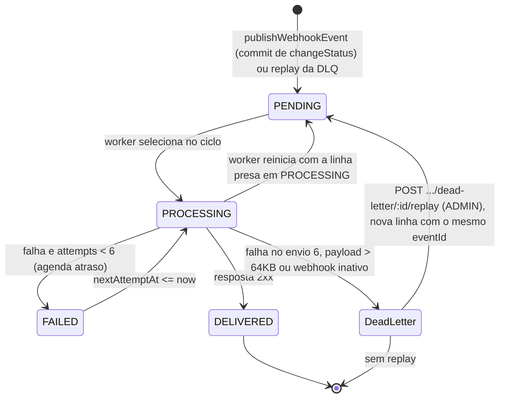
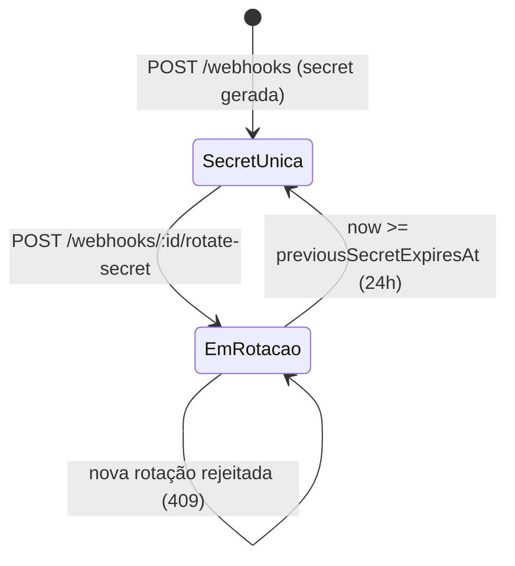

# FDD: Sistema de Webhooks de Notificação de Pedidos

| Campo | Valor |
| --- | --- |
| Status | Rascunho |
| Data | 2026-10-30 |
| Autor | Larissa (Tech Lead) |
| Relacionados | [PRD](PRD.md), [RFC](RFC.md), [ADRs](adrs/README.md) |

## 1. Contexto e Motivação Técnica

Hoje a mudança de status de um pedido acontece só em `OrderService.changeStatus` (`src/modules/orders/order.service.ts`), exposto em `PATCH /api/v1/orders/:id/status` (`src/app.ts`, `src/routes/index.ts`, `src/modules/orders/order.routes.ts`). O método abre um `$transaction` interativo que lê o pedido sem lock, valida a transição com `canTransition` (`src/modules/orders/order.status.ts`), ajusta o estoque, atualiza `orders.status` e insere uma linha em `order_status_history`.

O estoque **não** muda em toda transição, ao contrário do que foi descrito na reunião ("decrementa stock_quantity dos produtos do pedido", [09:04] Bruno). Pelo código, ele só é debitado em `PENDING → PAID` (`shouldDebitStock`) e só é reposto em `PAID → CANCELLED` ou `PROCESSING → CANCELLED` (`shouldReplenishStock`), ambos em `src/modules/orders/order.status.ts`. As outras transições só atualizam o pedido e o histórico.

O sistema não tem nenhuma comunicação de saída: não existe cliente HTTP, fila, worker, scheduler, HMAC nem geração de secrets ([mapeamento do código](research/mapeamento-codigo.md), seção Ausências). O único registro de "evento" é `order_status_history` (`prisma/schema.prisma`). Por isso os clientes B2B fazem polling em `GET /orders` ([09:00] Marcos).

A lacuna técnica é registrar cada mudança de status de forma atômica com a transação existente e entregá-la por HTTP assinado, fora do processo da API, com retry e evidência de falha.

## 2. Objetivos Técnicos

- Todo `changeStatus` que comita e cujo novo status é assinado por um webhook ativo do customer gera exatamente uma linha de outbox por webhook, na mesma transação. Um rollback não deixa nenhuma linha ([ADR-001](adrs/ADR-001-usar-outbox-no-mysql-para-eventos-de-webhook.md); [09:40] Bruno).
- O primeiro envio sai em menos de 10 segundos depois do commit, com um ciclo de polling de 2 segundos ([09:02] Marcos; [ADR-002](adrs/ADR-002-processar-outbox-com-worker-separado-em-polling.md)).
- Nenhuma chamada HTTP ao cliente acontece dentro da transação de `changeStatus` nem no processo da API ([09:04] Bruno; [09:11] Diego).
- Cada evento termina em um de dois estados: entregue, ou na `webhook_dead_letter` depois do envio inicial e de 5 retentativas ([ADR-004](adrs/ADR-004-retry-com-backoff-exponencial-e-dlq-em-tabela-separada.md); [09:17] Diego).
- Toda requisição de saída leva `X-Signature` com HMAC-SHA256 do corpo, usando a secret do endpoint ([ADR-005](adrs/ADR-005-assinar-webhooks-com-hmac-sha256-e-secret-por-endpoint.md)), e `X-Event-Id` estável entre retentativas e replay ([ADR-006](adrs/ADR-006-garantir-entrega-at-least-once-com-x-event-id.md)).
- Nenhuma dependência nova em `package.json`: HTTP com `fetch` nativo do Node 20 (`package.json`, `engines`), HMAC e secret com `node:crypto` ([ADR-007](adrs/ADR-007-reusar-padroes-existentes-do-projeto-no-modulo-de-webhooks.md); [09:29] Bruno).

## 3. Escopo e Exclusões

**Incluso:**
- Módulo `src/modules/webhooks` (a criar), com CRUD de configuração, rotação de secret, histórico de entregas e replay da DLQ ([09:27] Bruno; [09:33] Bruno; [09:34] Marcos; [09:18] Diego).
- Tabelas `webhooks`, `webhook_outbox`, `webhook_deliveries` e `webhook_dead_letter`, numa migration nova.
- Função `publishWebhookEvent(tx, order, fromStatus, toStatus)` chamada dentro de `changeStatus` ([09:41] Bruno).
- Processo `src/worker.ts` (a criar) e script `npm run worker` ([09:11] Larissa).

**Excluído:**
- Webhooks de entrada — [09:02] Marcos.
- Arquivamento das linhas entregues da outbox — [09:08] Diego.
- Email de aviso quando o webhook falha — [09:37] Larissa.
- Rate limiting de envio por cliente, que fica em observação — [09:39] Larissa.
- Dashboard visual para o cliente — [09:40] Larissa.
- Múltiplos workers — [09:13] Diego; [ADR-003](adrs/ADR-003-operar-com-worker-unico-e-ordering-por-order-id.md).
- Restrição por role do CRUD de configuração, adiada — [09:37] Sofia.
- Vínculo entre `User` e `Customer`. Não existe no código (`prisma/schema.prisma`) e não foi decidido ([RFC](RFC.md), Impacto e Riscos).
- Evento para o `PENDING` inicial. A criação do pedido grava o histórico `null → PENDING` em `OrderService.create` sem passar por `changeStatus` (`src/modules/orders/order.service.ts`), e a reunião não tratou desse caso (questão em aberto Q-07).

## 4. Modelo de Dados

Convenções herdadas de `prisma/schema.prisma`: id `String @id @default(uuid()) @db.Char(36)` ([09:51] Larissa), nome da tabela em snake_case via `@@map`, colunas em camelCase sem `@map`, `createdAt @default(now())` e `updatedAt @updatedAt`. `DateTime` vira `DATETIME(3)` no MySQL. Todos os models são novos, a criar.

### 4.1 `Webhook` → tabela `webhooks`

Configuração de um endpoint do cliente: "url + secret + customer_id + estado ativo" ([09:21] Bruno) e a lista de status assinados ([09:33] Marcos).

| Campo | Tipo Prisma / MySQL | Regra |
| --- | --- | --- |
| `id` | `String @db.Char(36)` | UUID, enviado como `X-Webhook-Id` ([09:44] Sofia) |
| `customerId` | `String @db.Char(36)` | FK para `customers.id`, `onDelete: Cascade` |
| `url` | `String @db.VarChar(2048)` | Só `https://` ([09:23] Sofia) |
| `events` | `Json` | Array de `OrderStatus`, sem `PENDING` (ver 6.1). Mesmo tipo de `Customer.address` |
| `secret` | `String @db.VarChar(128)` | Secret atual, recuperável para assinar ([ADR-005](adrs/ADR-005-assinar-webhooks-com-hmac-sha256-e-secret-por-endpoint.md), Consequências) |
| `previousSecret` | `String? @db.VarChar(128)` | Secret anterior durante o grace period |
| `previousSecretExpiresAt` | `DateTime?` | Rotação + 24h ([09:21] Sofia) |
| `active` | `Boolean @default(true)` | "estado ativo" ([09:21] Bruno). Mesmo padrão de `Product.active` |
| `createdAt`, `updatedAt` | `DateTime` | Convenção do schema |

Índices: `@@index([customerId])`. Relação inversa `webhooks Webhook[]` adicionada a `Customer`.

### 4.2 `WebhookOutbox` → tabela `webhook_outbox`

Uma linha por par (evento, webhook). Assim cada endpoint tem retry, `X-Webhook-Id` e histórico próprios (questão levantada em [decisões candidatas](research/decisoes-candidatas.md), "Filtrar por status assinado na inserção da outbox").

| Campo | Tipo | Regra |
| --- | --- | --- |
| `id` | `String @db.Char(36)` | UUID da linha |
| `eventId` | `String @unique @db.Char(36)` | UUID gerado na inserção, enviado como `X-Event-Id` ([09:25] Diego). É preservado no replay (ver 5.4) |
| `webhookId` | `String @db.Char(36)` | FK para `webhooks.id`, `onDelete: Cascade` |
| `orderId` | `String @db.Char(36)` | **Sem FK** para `orders`: `DELETE /orders/:id` é permitido em `CANCELLED` (`src/modules/orders/order.service.ts`), e uma FK faria o delete falhar com `P2003`, que o `errorMiddleware` devolve como 500 (`src/middlewares/error.middleware.ts`) |
| `eventType` | `String @db.VarChar(64)` | `order.status_changed` ([09:43] Diego) |
| `payload` | `Json` | Snapshot do corpo, renderizado na inserção ([ADR-008](adrs/ADR-008-gravar-payload-como-snapshot-na-insercao.md)) |
| `status` | enum `WebhookOutboxStatus` | `PENDING`, `PROCESSING`, `FAILED`, `DELIVERED` ("pendente, processando, falhou, entregue", [09:08] Diego) |
| `attempts` | `Int @default(0)` | Envios já feitos, de 0 a 6 |
| `nextAttemptAt` | `DateTime @default(now())` | Quando o evento fica elegível para o próximo envio |
| `lastError` | `String? @db.Text` | Resumo da última falha |
| `deliveredAt` | `DateTime?` | Preenchido no sucesso |
| `createdAt`, `updatedAt` | `DateTime` | `createdAt` define a ordem de leitura ([09:12] Diego) |

Índices: `@@index([status, nextAttemptAt])` para a consulta do worker, `@@index([createdAt])` ([09:08] Diego), `@@index([webhookId])` e `@@index([orderId])`.

`FAILED` significa "falhou, com nova tentativa agendada". A falha permanente não é um status da outbox: a linha sai da outbox e vai para `webhook_dead_letter` ([09:18] Diego).

### 4.3 `WebhookDelivery` → tabela `webhook_deliveries`

Uma linha por envio HTTP. Atende "sucesso/falha, payload, response, tempo de resposta" ([09:34] Marcos).

| Campo | Tipo | Regra |
| --- | --- | --- |
| `id` | `String @db.Char(36)` | UUID |
| `webhookId` | `String @db.Char(36)` | FK para `webhooks.id`, `onDelete: Cascade` |
| `eventId` | `String @db.Char(36)` | Sem FK, porque a linha da outbox pode ir para a DLQ |
| `attempt` | `Int` | 1 é o envio inicial, 2 a 6 são as retentativas |
| `success` | `Boolean` | `true` só em resposta 2xx |
| `requestBody` | `Json` | Corpo enviado |
| `responseStatus` | `Int?` | `null` em timeout ou erro de rede |
| `responseBody` | `String? @db.Text` | Truncado (Q-05) |
| `durationMs` | `Int` | Tempo até a resposta ou até o timeout |
| `error` | `String? @db.VarChar(500)` | Ex.: `timeout`, `ECONNREFUSED`, `http_503` |
| `attemptedAt` | `DateTime @default(now())` | |

Índices: `@@index([webhookId, attemptedAt])`.

### 4.4 `WebhookDeadLetter` → tabela `webhook_dead_letter`

"com a payload, motivo da falha e timestamp" ([09:18] Diego).

| Campo | Tipo | Regra |
| --- | --- | --- |
| `id` | `String @db.Char(36)` | UUID, usado em `/admin/webhooks/dead-letter/:id/replay` |
| `eventId` | `String @db.Char(36)` | Mesmo `X-Event-Id` do evento original |
| `webhookId` | `String @db.Char(36)` | FK para `webhooks.id`, `onDelete: Cascade` |
| `orderId` | `String @db.Char(36)` | Sem FK, pelo mesmo motivo da outbox |
| `eventType` | `String @db.VarChar(64)` | |
| `payload` | `Json` | Snapshot original |
| `reason` | `String @db.VarChar(64)` | `WEBHOOK_MAX_ATTEMPTS_EXCEEDED`, `WEBHOOK_PAYLOAD_TOO_LARGE` ou `WEBHOOK_INACTIVE` (seção 9) |
| `lastError` | `String? @db.Text` | Último erro HTTP ou de rede |
| `attempts` | `Int` | Envios feitos |
| `failedAt` | `DateTime @default(now())` | Timestamp da falha permanente |
| `replayedAt` | `DateTime?` | Preenchido no replay |
| `replayedById` | `String? @db.Char(36)` | FK para `users.id`, quem fez o replay ([09:36] Sofia) |

Índices: `@@index([webhookId])`, `@@index([failedAt])`, `@@index([eventId])`.

## 5. Fluxos Detalhados

### 5.1 Publicação do evento dentro de `changeStatus`

1. `PATCH /api/v1/orders/:id/status` chega a `OrderService.changeStatus`, que abre o `$transaction` (`src/modules/orders/order.service.ts`).
2. Seguem sem mudança: a leitura do pedido, as checagens `from === to` e `canTransition`, o débito de estoque (só `PENDING → PAID`), a reposição (só `PAID|PROCESSING → CANCELLED`), o `order.update` e o `orderStatusHistory.create`.
3. Logo depois do `orderStatusHistory.create` e antes da releitura do pedido, `changeStatus` chama `publishWebhookEvent(tx, order, from, to)` ([09:41] Bruno), que usa o mesmo `tx` e nunca o `prisma` global ([ADR-001](adrs/ADR-001-usar-outbox-no-mysql-para-eventos-de-webhook.md), Confirmação).
4. `publishWebhookEvent` lê `tx.webhook.findMany({ where: { customerId: order.customerId, active: true } })` e filtra em memória os webhooks cujo `events` contém `to`.
5. Se nenhum webhook assina `to`, a função retorna sem inserir nada ([09:34] Bruno).
6. Para cada webhook que assina, gera um `eventId` (UUID), monta o payload da seção 6.9 a partir do `order` lido no passo 2 e do `to`, e insere uma linha `PENDING` com `attempts = 0` e `nextAttemptAt = now()`. O log `webhook_event_enqueued` só é emitido depois do commit.
7. Se qualquer passo lança erro, o Prisma desfaz a transação inteira: status, histórico, estoque e outbox ([09:40] Bruno). O erro segue para o `errorMiddleware` como hoje.
8. Saída: commit, e o controller responde 200 com o pedido, como hoje (`src/modules/orders/order.controller.ts`).

```mermaid
sequenceDiagram
  participant C as Operador (JWT)
  participant API as OrderService.changeStatus
  participant P as publishWebhookEvent
  participant DB as MySQL
  C->>API: PATCH /api/v1/orders/:id/status
  API->>DB: BEGIN; SELECT order
  API->>DB: debit/replenish stock (só nas transições de estoque)
  API->>DB: UPDATE orders; INSERT order_status_history
  API->>P: publishWebhookEvent(tx, order, from, to)
  P->>DB: SELECT webhooks (customerId, active)
  alt algum webhook assina "to"
    P->>DB: INSERT webhook_outbox (PENDING) por webhook
  else nenhum assina
    P-->>API: retorna sem inserir
  end
  alt erro em qualquer passo
    API->>DB: ROLLBACK (status e outbox somem juntos)
    API-->>C: erro via errorMiddleware
  else sucesso
    API->>DB: COMMIT
    API-->>C: 200 pedido
  end
```

### 5.2 Ciclo do worker (caminho feliz)

1. `npm run worker` inicia `src/worker.ts`, que cria o próprio client com `createPrismaClient()` (`src/config/database.ts`) e não importa `src/app.ts` ([ADR-002](adrs/ADR-002-processar-outbox-com-worker-separado-em-polling.md), Confirmação; [09:30] Bruno).
2. Na partida, o worker devolve para `PENDING` as linhas que ficaram em `PROCESSING` por uma queda anterior (seção 9, Recuperação). Depois loga `webhook_worker_started`.
3. Cada ciclo busca até `WEBHOOK_BATCH_SIZE` linhas com `status IN (PENDING, FAILED) AND nextAttemptAt <= now()`, em `ORDER BY createdAt ASC` ([09:09] Diego; [09:12] Diego).
4. Marca as linhas do lote como `PROCESSING`.
5. Para cada linha, em sequência: carrega o webhook. Se ele estiver inativo, segue 5.3, passo 6. Senão, serializa `payload` uma vez (`body = JSON.stringify(payload)`) e confere o tamanho (seção 9).
6. Calcula `X-Signature` sobre `body` exatamente como será enviado (seção 10) e faz `fetch(url, { method: 'POST', body, headers, redirect: 'manual', signal: AbortSignal.timeout(10000) })` ([09:42] Diego).
7. Resposta 2xx: grava `webhook_deliveries` com `success = true` e atualiza a outbox para `DELIVERED`, com `deliveredAt` e `attempts + 1`. Loga `webhook_delivery_succeeded`.
8. Ao terminar o lote, agenda o próximo ciclo para 2 segundos depois (`setTimeout`, não `setInterval`, para que dois ciclos não se sobreponham) ([09:09] Diego).
9. Saída: em SIGINT ou SIGTERM, o worker para de agendar ciclos, espera o envio em andamento terminar, chama `$disconnect()` e sai, no mesmo modelo de `src/server.ts`.

```mermaid
sequenceDiagram
  participant W as Worker (src/worker.ts)
  participant DB as MySQL
  participant CL as Endpoint do cliente (https)
  loop a cada 2s após o fim do lote
    W->>DB: SELECT outbox WHERE status IN (PENDING, FAILED) AND nextAttemptAt <= now ORDER BY createdAt LIMIT batch
    W->>DB: UPDATE status = PROCESSING
    loop cada evento, em sequência
      W->>W: body = JSON.stringify(payload); checa 64KB; assina HMAC
      W->>CL: POST url (X-Event-Id, X-Signature, X-Timestamp, X-Webhook-Id)
      CL-->>W: 2xx
      W->>DB: INSERT webhook_deliveries (success)
      W->>DB: UPDATE outbox status = DELIVERED
    end
  end
```

### 5.3 Falha transitória e falha permanente

1. Conta como falha uma resposta fora de 2xx (3xx incluído, porque redirects não são seguidos: seguir um `Location` poderia levar o envio para uma URL `http`, contornando a exigência de `https` de [09:23] Sofia), um timeout de 10s ([09:42] Diego) ou um erro de rede.
2. O worker grava `webhook_deliveries` com `success = false`, `responseStatus` (ou `null`), `durationMs` e `error`.
3. Se `attempts + 1 < 6`: atualiza a outbox para `FAILED`, com `attempts + 1`, `lastError` e `nextAttemptAt = now + atraso[attempts]`, usando a tabela da seção 9. Loga `webhook_delivery_failed`.
4. Quando `nextAttemptAt` passa, o passo 3 de 5.2 volta a selecionar a linha.
5. Se o envio 6 (a quinta retentativa) falha: numa transação, insere `webhook_dead_letter` com `reason = WEBHOOK_MAX_ATTEMPTS_EXCEEDED` e apaga a linha da outbox ([09:18] Diego). Loga `webhook_moved_to_dead_letter`.
6. Webhook inativo no momento do envio: a linha vai direto para a DLQ com `reason = WEBHOOK_INACTIVE`, sem envio. **Decisão deste FDD, não discutida na reunião.** Enviar ignoraria o "estado ativo" do cadastro ([09:21] Bruno). Manter a linha na outbox até o webhook voltar deixaria o evento "pendurado pra sempre" se ele nunca voltar ([09:15] Diego). A DLQ guarda a evidência e permite o replay depois da reativação ([09:18] Diego). A confirmação fica para a sessão de revisão do design ([09:50] Larissa). Se o webhook foi apagado, o `onDelete: Cascade` já removeu as linhas.
7. Payload acima de 64KB: vai direto para a DLQ com `reason = WEBHOOK_PAYLOAD_TOO_LARGE`, sem envio e sem retry ("Eu sou a favor de erra", [09:23] Sofia; [09:24] Larissa).

```mermaid
sequenceDiagram
  participant W as Worker
  participant DB as MySQL
  participant CL as Endpoint do cliente
  W->>CL: POST (envio n)
  alt timeout 10s, erro de rede ou não-2xx
    CL--xW: falha
    W->>DB: INSERT webhook_deliveries (success=false)
    alt n < 6
      W->>DB: UPDATE outbox status=FAILED, attempts=n, nextAttemptAt=now+atraso[n]
    else n = 6
      W->>DB: BEGIN; INSERT webhook_dead_letter (WEBHOOK_MAX_ATTEMPTS_EXCEEDED); DELETE outbox; COMMIT
    end
  end
```

### 5.4 Replay da DLQ

1. Um ADMIN chama `POST /api/v1/admin/webhooks/dead-letter/:id/replay` ([09:18] Diego; [09:36] Larissa).
2. `authenticate` e `requireRole('ADMIN')` (`src/middlewares/auth.middleware.ts`) barram quem não é ADMIN com 403 `FORBIDDEN`.
3. Numa transação: lê a linha da DLQ e rejeita se não existir (`WEBHOOK_DEAD_LETTER_NOT_FOUND`) ou se `replayedAt` já estiver preenchido (`WEBHOOK_DEAD_LETTER_ALREADY_REPLAYED`). A marcação usa `updateMany({ where: { id, replayedAt: null } })` e confere `count === 1`, para que dois replays simultâneos não gerem duas linhas. **A recusa de replay repetido é decisão deste FDD, não discutida na reunião**, que só define que o replay "Recoloca na outbox como pendente" ([09:18] Diego). A confirmação fica para a sessão de revisão do design (Q-14).
4. Rejeita se o webhook estiver inativo (`WEBHOOK_INACTIVE`). **Decisão deste FDD, não discutida na reunião.** Se o replay fosse aceito, o worker devolveria o evento à DLQ no ciclo seguinte (5.3, passo 6). O `replayedAt` da linha original ficaria marcado sem que nada tivesse sido enviado, e surgiria uma linha nova na DLQ. O 409 avisa o ADMIN para reativar o webhook antes. A confirmação fica para a sessão de revisão do design ([09:50] Larissa).
5. Insere na outbox uma linha `PENDING` com o mesmo `eventId`, `webhookId`, `orderId`, `eventType` e `payload`, `attempts = 0` e `nextAttemptAt = now()` ("Recoloca na outbox como pendente", [09:18] Diego). O `eventId` é o mesmo porque o `X-Event-Id` é "único por evento" ([09:25] Diego), e o replay reenvia o mesmo evento.
6. Preenche `replayedAt` e `replayedById = req.user.id`. Depois do commit, loga `webhook_dead_letter_replayed` com quem fez o replay ([09:36] Sofia).
7. Saída: 202, e o evento entra no ciclo de 5.2 com um ciclo completo de 6 envios.

```mermaid
sequenceDiagram
  participant A as ADMIN
  participant API as WebhookService.replay
  participant DB as MySQL
  A->>API: POST /api/v1/admin/webhooks/dead-letter/:id/replay
  API->>API: authenticate + requireRole('ADMIN')
  API->>DB: BEGIN; SELECT dead_letter; UPDATE replayedAt WHERE replayedAt IS NULL
  alt não existe / já reprocessado / webhook inativo
    API->>DB: ROLLBACK
    API-->>A: 404 / 409
  else ok
    API->>DB: INSERT webhook_outbox (PENDING, mesmo eventId)
    API->>DB: COMMIT
    API-->>A: 202
  end
```

### 5.5 Rotação de secret

1. `POST /api/v1/webhooks/:id/rotate-secret` (o caminho é proposta, Q-01) ([09:21] Sofia).
2. Se `previousSecretExpiresAt > now`, rejeita com `WEBHOOK_SECRET_ROTATION_IN_PROGRESS`, para que nunca existam mais de duas secrets válidas ([ADR-005](adrs/ADR-005-assinar-webhooks-com-hmac-sha256-e-secret-por-endpoint.md), Consequências: "durante as 24h, duas secrets estão válidas"). **Decisão deste FDD, não discutida na reunião.** A reunião só define que a antiga fica válida por 24 horas ([09:21] Sofia). A confirmação fica para a revisão (Q-13).
3. Gera uma nova secret (seção 10). Grava `previousSecret = secret`, `secret = nova` e `previousSecretExpiresAt = now + 24h`.
4. Responde 200 com a nova secret. É a única outra resposta, além da criação, que devolve uma secret.
5. Durante as 24h, o worker assina com as duas secrets (seção 10). Depois disso, ignora `previousSecret` ("Depois disso, a antiga morre", [09:21] Sofia). A expiração é lazy, sem job de limpeza.

### 5.6 Ciclos de vida





## 6. Contratos Públicos

Todas as rotas ficam sob `/api/v1` (`src/app.ts`) e entram em `buildApiRouter` (`src/routes/index.ts`). Os erros seguem o formato `{ "error": { "code", "message", "details?" } }` (`src/middlewares/error.middleware.ts`). As listagens usam `{ data, pagination }` (`src/shared/http/response.ts`). Os ids de rota são validados com `z.string().uuid()`, como em `src/modules/orders/order.schemas.ts`.

**Autorização comum ao CRUD, rotação e deliveries:** `authenticate`, aceitando qualquer role ([09:36] Marcos; [09:37] Sofia). O `customerId` vem no body ou na query, e não do JWT ([09:32] Larissa). Não há checagem de que o usuário tem direito sobre aquele customer, porque o código não tem esse vínculo (Riscos, R-01).

**Representação de um webhook** (sem `secret` nem `previousSecret`, no mesmo espírito de `UserService.toPublic`, que omite `passwordHash`, `src/modules/users/user.service.ts`):

```json
{
  "id": "6f1c2a7e-3b0d-4c8e-9a51-2d7f0e4b8c11",
  "customerId": "0b8e5c3a-1f2d-4a6b-8c9e-7d5f3a1b2c40",
  "url": "https://hooks.atlascomercial.com.br/orders",
  "events": ["SHIPPED", "DELIVERED"],
  "active": true,
  "previousSecretExpiresAt": null,
  "createdAt": "2026-11-03T13:20:00.000Z",
  "updatedAt": "2026-11-03T13:20:00.000Z"
}
```

### 6.1 `POST /api/v1/webhooks`

- **Autenticação/autorização:** `Authorization: Bearer <JWT>`, qualquer role.
- **Headers:** `Content-Type: application/json`.
- **Request:** `url` precisa ser `https` ([09:23] Sofia). `events` é um array não vazio, sem repetição, de `PAID | PROCESSING | SHIPPED | DELIVERED | CANCELLED` ([09:33] Marcos). `PENDING` fica de fora porque nenhuma transição de `order.status.ts` chega a `PENDING`, então a assinatura nunca dispararia. O cliente não envia secret: ela é gerada pela plataforma ([09:31] Marcos).
```json
{
  "customerId": "0b8e5c3a-1f2d-4a6b-8c9e-7d5f3a1b2c40",
  "url": "https://hooks.atlascomercial.com.br/orders",
  "events": ["SHIPPED", "DELIVERED"]
}
```
- **Responses:**
  - `201` — webhook criado e ativo. A `secret` aparece só nesta resposta e na rotação ([09:31] Marcos).
```json
{
  "id": "6f1c2a7e-3b0d-4c8e-9a51-2d7f0e4b8c11",
  "customerId": "0b8e5c3a-1f2d-4a6b-8c9e-7d5f3a1b2c40",
  "url": "https://hooks.atlascomercial.com.br/orders",
  "events": ["SHIPPED", "DELIVERED"],
  "active": true,
  "secret": "9f2c4e7a1b3d5f60718293a4b5c6d7e8f90a1b2c3d4e5f60718293a4b5c6d7e8",
  "previousSecretExpiresAt": null,
  "createdAt": "2026-11-03T13:20:00.000Z",
  "updatedAt": "2026-11-03T13:20:00.000Z"
}
```
  - `400` — URL sem `https` → `WEBHOOK_INVALID_URL`. Outro campo inválido (uuid, `events` vazio ou com `PENDING`, URL malformada) → `VALIDATION_ERROR`.
  - `401` — sem token ou token inválido → `UNAUTHORIZED`.
  - `404` — `customerId` não existe → `WEBHOOK_CUSTOMER_NOT_FOUND`. A checagem é feita no service, porque uma FK violada viraria 500 (`P2003` não é tratado em `src/middlewares/error.middleware.ts`).

### 6.2 `GET /api/v1/webhooks`

- **Autenticação/autorização:** JWT, qualquer role.
- **Headers:** nenhum além de `Authorization`.
- **Request:** `?customerId=<uuid>&page=1&pageSize=20`. `customerId` é obrigatório. `page` e `pageSize` seguem `listOrdersQuerySchema` (`src/modules/orders/order.schemas.ts`), com `pageSize` entre 1 e 100. Lista "os webhooks de um customer" ([09:33] Bruno).
- **Responses:**
  - `200` — página de webhooks, sem secrets.
```json
{
  "data": [
    {
      "id": "6f1c2a7e-3b0d-4c8e-9a51-2d7f0e4b8c11",
      "customerId": "0b8e5c3a-1f2d-4a6b-8c9e-7d5f3a1b2c40",
      "url": "https://hooks.atlascomercial.com.br/orders",
      "events": ["SHIPPED", "DELIVERED"],
      "active": true,
      "previousSecretExpiresAt": null,
      "createdAt": "2026-11-03T13:20:00.000Z",
      "updatedAt": "2026-11-03T13:20:00.000Z"
    }
  ],
  "pagination": { "page": 1, "pageSize": 20, "total": 1, "totalPages": 1 }
}
```
  - `400` — `customerId` ausente ou inválido → `VALIDATION_ERROR`.
  - `401` → `UNAUTHORIZED`.

### 6.3 `GET /api/v1/webhooks/:id`

Proposta deste FDD, no padrão de `GET /orders/:id` (`src/modules/orders/order.routes.ts`). A reunião listou só PATCH, DELETE e a listagem por customer ([09:33] Bruno).

- **Autenticação/autorização:** JWT, qualquer role.
- **Headers:** `Authorization`.
- **Request:** sem corpo. `:id` é um uuid.
- **Responses:**
  - `200` — o webhook, no formato da representação acima.
  - `400` — `:id` não é uuid → `VALIDATION_ERROR`.
  - `401` → `UNAUTHORIZED`.
  - `404` → `WEBHOOK_NOT_FOUND`.

### 6.4 `PATCH /api/v1/webhooks/:id`

- **Autenticação/autorização:** JWT, qualquer role ([09:33] Bruno).
- **Headers:** `Content-Type: application/json`.
- **Request:** um ou mais campos entre `url`, `events` e `active`, com as mesmas regras do POST. `customerId` e secret não são editáveis. A mudança vale para os próximos `changeStatus`. Eventos já gravados na outbox não mudam, porque o filtro é aplicado na inserção ([09:34] Bruno).
```json
{ "events": ["PAID", "SHIPPED", "DELIVERED"], "active": true }
```
- **Responses:**
  - `200` — webhook atualizado, sem secret.
```json
{
  "id": "6f1c2a7e-3b0d-4c8e-9a51-2d7f0e4b8c11",
  "customerId": "0b8e5c3a-1f2d-4a6b-8c9e-7d5f3a1b2c40",
  "url": "https://hooks.atlascomercial.com.br/orders",
  "events": ["PAID", "SHIPPED", "DELIVERED"],
  "active": true,
  "previousSecretExpiresAt": null,
  "createdAt": "2026-11-03T13:20:00.000Z",
  "updatedAt": "2026-11-04T09:02:11.000Z"
}
```
  - `400` — `url` sem `https` → `WEBHOOK_INVALID_URL`. Corpo vazio ou campo inválido → `VALIDATION_ERROR`.
  - `401` → `UNAUTHORIZED`.
  - `404` → `WEBHOOK_NOT_FOUND`.

### 6.5 `DELETE /api/v1/webhooks/:id`

- **Autenticação/autorização:** JWT, qualquer role ([09:33] Bruno).
- **Headers:** `Authorization`.
- **Request:** sem corpo.
- **Responses:**
  - `204` — removido, sem corpo, como em `src/modules/orders/order.controller.ts`. O cascade apaga também os eventos pendentes, o histórico de entregas e as linhas da DLQ desse webhook (R-09).
  - `401` → `UNAUTHORIZED`.
  - `404` → `WEBHOOK_NOT_FOUND`.

### 6.6 `POST /api/v1/webhooks/:id/rotate-secret`

- **Autenticação/autorização:** JWT, qualquer role ("Endpoint pro cliente conseguir pedir nova secret pela API", [09:21] Sofia). O caminho é proposta deste FDD (Q-01).
- **Headers:** `Authorization`. Sem corpo.
- **Request:** sem corpo.
- **Responses:**
  - `200` — nova secret. A anterior continua válida até `previousSecretExpiresAt` ([09:21] Sofia).
```json
{
  "id": "6f1c2a7e-3b0d-4c8e-9a51-2d7f0e4b8c11",
  "secret": "3a5c7e9f0b1d2f4a6c8e0a2b4d6f8a0c1e3a5c7e9f0b1d2f4a6c8e0a2b4d6f8a",
  "previousSecretExpiresAt": "2026-11-05T10:00:00.000Z"
}
```
  - `401` → `UNAUTHORIZED`.
  - `404` → `WEBHOOK_NOT_FOUND`.
  - `409` — já existe rotação em grace period → `WEBHOOK_SECRET_ROTATION_IN_PROGRESS` (decisão deste FDD, não discutida na reunião; 5.5, passo 2).

### 6.7 `GET /api/v1/webhooks/:id/deliveries`

- **Autenticação/autorização:** JWT, qualquer role ([09:34] Marcos; [09:37] Sofia).
- **Headers:** `Authorization`.
- **Request:** `?page=1&pageSize=100`. `pageSize` entre 1 e 100, padrão 20, que cobre "os últimos 100" ([09:34] Marcos). A ordenação é `attemptedAt DESC`, e cada item é um envio HTTP.
- **Responses:**
  - `200`
```json
{
  "data": [
    {
      "id": "c3d9a1e2-4b5f-4a6c-8d7e-9f0a1b2c3d4e",
      "eventId": "1e7b9c2d-5a3f-4e8b-9c1d-2f4a6b8c0d1e",
      "attempt": 2,
      "success": true,
      "requestBody": {
        "event_id": "1e7b9c2d-5a3f-4e8b-9c1d-2f4a6b8c0d1e",
        "event_type": "order.status_changed",
        "timestamp": "2026-11-04T14:30:00.123Z",
        "order_id": "9a8b7c6d-5e4f-4a3b-8c2d-1e0f9a8b7c6d",
        "order_number": "ORD-000042",
        "from_status": "PROCESSING",
        "to_status": "SHIPPED",
        "customer_id": "0b8e5c3a-1f2d-4a6b-8c9e-7d5f3a1b2c40",
        "total_cents": 158990
      },
      "responseStatus": 200,
      "responseBody": "{\"received\":true}",
      "durationMs": 312,
      "error": null,
      "attemptedAt": "2026-11-04T14:31:02.410Z"
    }
  ],
  "pagination": { "page": 1, "pageSize": 100, "total": 1, "totalPages": 1 }
}
```
  - `400` — `:id` ou paginação inválidos → `VALIDATION_ERROR`.
  - `401` → `UNAUTHORIZED`.
  - `404` → `WEBHOOK_NOT_FOUND`.

### 6.8 `POST /api/v1/admin/webhooks/dead-letter/:id/replay`

- **Autenticação/autorização:** JWT com role `ADMIN`, via `requireRole('ADMIN')` (`src/middlewares/auth.middleware.ts`; [09:36] Sofia; [09:36] Larissa). Fica num router `/admin` novo, montado em `buildApiRouter`.
- **Headers:** `Authorization`. Sem corpo.
- **Request:** sem corpo. `:id` é o id da linha em `webhook_dead_letter`. Não há endpoint para listar a DLQ (Q-06). O id aparece no log `webhook_moved_to_dead_letter`.
- **Responses:**
  - `202` — evento recolocado na outbox como pendente ([09:18] Diego). A entrega é assíncrona.
```json
{
  "deadLetterId": "5b6c7d8e-9f0a-4b1c-8d2e-3f4a5b6c7d8e",
  "eventId": "1e7b9c2d-5a3f-4e8b-9c1d-2f4a6b8c0d1e",
  "outboxId": "7c8d9e0f-1a2b-4c3d-8e4f-5a6b7c8d9e0f",
  "replayedAt": "2026-11-05T11:00:00.000Z",
  "replayedById": "2d3e4f5a-6b7c-4d8e-9f0a-1b2c3d4e5f6a"
}
```
  - `401` → `UNAUTHORIZED`.
  - `403` — role diferente de ADMIN → `FORBIDDEN` (código existente do `requireRole`).
  - `404` → `WEBHOOK_DEAD_LETTER_NOT_FOUND`.
  - `409` — já reprocessado → `WEBHOOK_DEAD_LETTER_ALREADY_REPLAYED` (decisão deste FDD, não discutida na reunião; 5.4, passo 3). Webhook inativo → `WEBHOOK_INACTIVE` (decisão deste FDD, não discutida na reunião; 5.4, passo 4).

### 6.9 Chamada de saída: `POST {webhook.url}`

- **Autenticação:** nenhuma credencial da plataforma é enviada. O cliente valida a origem pela assinatura ([09:19] Sofia).
- **Transporte:** só `https` ([09:23] Sofia). Timeout de 10s ([09:42] Diego). Redirects não são seguidos (`redirect: 'manual'`), porque o destino de um `Location` poderia ser `http` e furar a exigência de `https` ([09:23] Sofia). Um 3xx conta como falha.
- **Headers** ([09:44] Diego; [09:44] Sofia):

| Header | Valor | Fonte |
| --- | --- | --- |
| `Content-Type` | `application/json` | [09:44] Diego |
| `X-Event-Id` | `eventId` da linha, igual em todas as retentativas e no replay | [09:25] Diego |
| `X-Signature` | HMAC-SHA256 do corpo, em hex. Durante a rotação, duas assinaturas separadas por vírgula, com a da secret atual primeiro (Q-02) | [09:22] Sofia |
| `X-Timestamp` | Momento do envio, em ISO 8601, recalculado a cada tentativa. **Não entra na assinatura** (R-02) | [09:44] Diego |
| `X-Webhook-Id` | `webhooks.id` | [09:44] Sofia |

- **Request (corpo):** o snapshot gravado na inserção ([ADR-008](adrs/ADR-008-gravar-payload-como-snapshot-na-insercao.md); [09:43] Diego). Os campos são snake_case. Os valores vêm de colunas camelCase (`orderNumber`, `totalCents`, `customerId` em `prisma/schema.prisma`). Sem items ([09:43] Diego). `timestamp` é o momento da mudança de status, e `X-Timestamp` é o momento do envio.
```json
{
  "event_id": "1e7b9c2d-5a3f-4e8b-9c1d-2f4a6b8c0d1e",
  "event_type": "order.status_changed",
  "timestamp": "2026-11-04T14:30:00.123Z",
  "order_id": "9a8b7c6d-5e4f-4a3b-8c2d-1e0f9a8b7c6d",
  "order_number": "ORD-000042",
  "from_status": "PROCESSING",
  "to_status": "SHIPPED",
  "customer_id": "0b8e5c3a-1f2d-4a6b-8c9e-7d5f3a1b2c40",
  "total_cents": 158990
}
```
- **Responses esperadas do cliente:**
  - `2xx` — entregue. O corpo é guardado em `webhook_deliveries.responseBody`, truncado.
  - Qualquer outro status, timeout ou erro de rede — falha, e entra no retry da seção 9.
- **Obrigações do cliente**, documentadas no portal pelo Marcos ([09:26] Marcos): validar `X-Signature` e deduplicar por `X-Event-Id`, porque a entrega é at-least-once ([ADR-006](adrs/ADR-006-garantir-entrega-at-least-once-com-x-event-id.md)).

## 7. Matriz de Erros

Classes novas em `src/modules/webhooks/webhook.errors.ts` (a criar), seguindo `InvalidStatusTransitionError extends ConflictError` (`src/shared/errors/http-errors.ts`). Onde a classe existente fixa o código (`NotFoundError` sempre usa `NOT_FOUND`, `ValidationError` sempre usa `VALIDATION_ERROR`), a classe nova estende `AppError` ou `BadRequestError`, que aceitam código próprio. Todas são serializadas pelo `errorMiddleware` sem mudança ([09:29] Bruno).

| Código | HTTP | Quando ocorre | Classe base | Mensagem |
| --- | --- | --- | --- | --- |
| `WEBHOOK_NOT_FOUND` | 404 | `:id` de webhook inexistente em GET, PATCH, DELETE, rotate-secret ou deliveries | `AppError` | `Webhook not found` |
| `WEBHOOK_INVALID_URL` | 400 | `url` com esquema diferente de `https:` no POST ou PATCH | `BadRequestError` | `Webhook URL must use https` |
| `WEBHOOK_CUSTOMER_NOT_FOUND` | 404 | `customerId` do POST não existe em `customers` | `AppError` | `Customer not found` |
| `WEBHOOK_SECRET_ROTATION_IN_PROGRESS` | 409 | Rotação pedida com `previousSecretExpiresAt > now`. Decisão deste FDD, não discutida na reunião (5.5, passo 2) | `ConflictError` | `A secret rotation is already in its grace period` |
| `WEBHOOK_DEAD_LETTER_NOT_FOUND` | 404 | `:id` inexistente em `webhook_dead_letter` | `AppError` | `Dead letter entry not found` |
| `WEBHOOK_DEAD_LETTER_ALREADY_REPLAYED` | 409 | Linha da DLQ com `replayedAt` preenchido. Decisão deste FDD, não discutida na reunião (5.4, passo 3) | `ConflictError` | `Dead letter entry was already replayed` |
| `WEBHOOK_INACTIVE` | 409 | Replay para um webhook com `active = false`. Decisão deste FDD, não discutida na reunião (5.4, passo 4) | `ConflictError` | `Webhook is inactive` |

Os códigos existentes `VALIDATION_ERROR` (400), `UNAUTHORIZED` (401) e `FORBIDDEN` (403) são reusados sem mudança.

Sobre `WEBHOOK_INVALID_URL`: o `validate` converte qualquer `ZodError` em `VALIDATION_ERROR` (`src/middlewares/validate.middleware.ts`), então um `refine` no schema não consegue emitir o código próprio. A regra de `https` fica num helper em `webhook.schemas.ts` (o schema Zod continua sendo a fonte da regra, como pediu [09:23] Sofia) e é chamada no service, que lança `WEBHOOK_INVALID_URL`. Em Zod 3.23.8, `z.string().url()` aceita qualquer esquema ([verificação externa](research/verificacao-externa.md), VER-008).

`WEBHOOK_SECRET_REQUIRED`, citado como exemplo em [09:28] Bruno, não é criado: a secret é gerada pela plataforma e nunca é enviada pelo cliente ([09:31] Marcos).

## 8. Configuração

As variáveis entram em `envSchema` (`src/config/env.ts`) com `z.coerce.number()` e default, como `PORT`. Os valores decididos na reunião ficam como constantes do módulo, em `src/modules/webhooks/webhook.constants.ts` (a criar), e não como variáveis de ambiente.

| Parâmetro | Valor padrão | Fonte |
| --- | --- | --- |
| `WEBHOOK_POLL_INTERVAL_MS` (env) | `2000` | [09:09] Diego; [09:10] Larissa |
| `WEBHOOK_HTTP_TIMEOUT_MS` (env) | `10000` | [09:42] Diego |
| `WEBHOOK_BATCH_SIZE` (env) | `10` — proposta, sem fonte numérica | "batch pequeno", [09:08] Diego; Q-04 |
| `RETRY_DELAYS_MS` (constante) | `[60000, 300000, 1800000, 7200000, 43200000]` | [09:17] Diego |
| `MAX_SENDS` (constante) | `6` (envio inicial + 5 retentativas) | [09:17] Diego ("quase 15 horas") |
| `MAX_PAYLOAD_BYTES` (constante) | `65536` | [09:24] Diego; [09:24] Larissa |
| `SECRET_GRACE_PERIOD_MS` (constante) | `86400000` (24h) | [09:21] Sofia |
| `SECRET_BYTES` (constante) | `32` — proposta, a revisar | [09:46] Sofia (revisão da geração de secret); Q-03 |
| `DELIVERIES_MAX_PAGE_SIZE` (constante) | `100` | [09:34] Marcos |
| `RESPONSE_BODY_MAX_CHARS` (constante) | a definir | Q-05 |
| `EVENT_TYPE` (constante) | `order.status_changed` | [09:43] Diego |
| `DATABASE_URL` (env existente) | mesma da API | [09:30] Bruno |

## 9. Estratégias de Resiliência

**Timeout:** 10s por envio, com `AbortSignal.timeout` ([09:42] Diego). Um timeout conta como falha e vai para retry.

**Retry e backoff** ([ADR-004](adrs/ADR-004-retry-com-backoff-exponencial-e-dlq-em-tabela-separada.md)). O ADR registra "5 tentativas" e deixa em aberto se o envio inicial conta. Este FDD fecha o ponto como **envio inicial + 5 retentativas**, porque só assim a soma dos atrasos dá "quase 15 horas entre primeira falha e última tentativa" ([09:17] Diego). O atraso é contado a partir do fim do envio que falhou, e não há jitter (R-03).

| Envio | `attempts` antes | Agendado para | Acumulado desde a 1ª falha |
| --- | --- | --- | --- |
| 1 (inicial) | 0 | próximo ciclo depois do commit (≤ 2s) | — |
| 2 (1ª retentativa) | 1 | falha do envio 1 + 1 min | 1 min |
| 3 (2ª retentativa) | 2 | falha do envio 2 + 5 min | 6 min |
| 4 (3ª retentativa) | 3 | falha do envio 3 + 30 min | 36 min |
| 5 (4ª retentativa) | 4 | falha do envio 4 + 2 h | 2 h 36 min |
| 6 (5ª retentativa) | 5 | falha do envio 5 + 12 h | 14 h 36 min |
| falha do envio 6 | 6 | move para `webhook_dead_letter` | — |

O acumulado ignora até 10s de timeout por envio e até 2s de espera do ciclo.

**Destino de falha permanente:** `webhook_dead_letter`, com o motivo em `reason`:

| `reason` | Quando | Retry? |
| --- | --- | --- |
| `WEBHOOK_MAX_ATTEMPTS_EXCEEDED` | Falha do envio 6 | Não. Só por replay ADMIN |
| `WEBHOOK_PAYLOAD_TOO_LARGE` | `Buffer.byteLength(body) > 65536` ([09:24] Larissa) | Não. O replay volta a falhar enquanto o snapshot for o mesmo |
| `WEBHOOK_INACTIVE` | Webhook com `active = false` no momento do envio. Decisão deste FDD, não discutida na reunião (5.3, passo 6) | Não. Replay depois de reativar |

**Fallback:** não há. O email de aviso ficou para a próxima fase ([09:37] Larissa).

**Recuperação de queda:** se o worker morre com linhas em `PROCESSING`, a próxima partida devolve essas linhas para `PENDING`. Um envio que chegou ao cliente sem a gravação do resultado é reenviado com o mesmo `X-Event-Id`. Esse é o caso at-least-once que o cliente deduplica ([ADR-006](adrs/ADR-006-garantir-entrega-at-least-once-com-x-event-id.md); [verificação externa](research/verificacao-externa.md), VER-001).

**Concorrência e ordenação:** roda um único worker ([ADR-003](adrs/ADR-003-operar-com-worker-unico-e-ordering-por-order-id.md)). Dentro do lote os envios são sequenciais, em `createdAt ASC`, e o próximo ciclo só começa depois do fim do anterior. A garantia publicada é a do ADR: "Não é garantia de ordering global, só por order_id e enquanto for single-worker" ([09:13] Larissa). O worker **não** segura os eventos seguintes de um pedido enquanto um anterior está em `FAILED`, então um evento em retry pode ser ultrapassado (R-04).

**Idempotência:** no cliente, por `X-Event-Id` ([09:25] Diego). Na plataforma: `eventId` é `@unique` na outbox, e o replay marca `replayedAt` com update condicional, então um duplo clique não cria dois eventos.

**Isolamento de falha:** como o HTTP fica fora da transação, um cliente fora do ar não afeta `changeStatus` ([09:04] Bruno). Como os envios do worker são sequenciais, um cliente lento atrasa os outros (R-05).

## 10. Segurança

- **Assinatura:** `HMAC-SHA256(secret, body)` com `crypto.createHmac('sha256', secret).update(body).digest('hex')`, onde `body` é a mesma string enviada no POST ([ADR-005](adrs/ADR-005-assinar-webhooks-com-hmac-sha256-e-secret-por-endpoint.md); [09:20] Sofia). O formato do header (hex, sem prefixo) é proposta a confirmar na revisão da Sofia (Q-02).
- **Rotação:** enquanto `previousSecretExpiresAt > now`, `X-Signature` leva `hmac(secret),hmac(previousSecret)`, para que a secret antiga continue "válida por 24 horas em paralelo" ([09:21] Sofia). Depois disso, só a atual.
- **Geração de secret:** `crypto.randomBytes(32).toString('hex')`, de `node:crypto`, sem dependência nova ([ADR-007](adrs/ADR-007-reusar-padroes-existentes-do-projeto-no-modulo-de-webhooks.md)). A Sofia revisa a geração de secret antes do deploy ([09:46] Sofia).
- **Armazenamento da secret:** em texto, nas colunas `secret` e `previousSecret`, porque o worker precisa dela para assinar, e um hash como o da senha (`bcrypt`, `src/modules/users/user.service.ts`) não serve ([ADR-005](adrs/ADR-005-assinar-webhooks-com-hmac-sha256-e-secret-por-endpoint.md), Consequências). A cifragem em repouso não foi discutida e fica como risco (R-06).
- **Exposição da secret:** só nas respostas 201 do POST e 200 do rotate-secret. GET, PATCH e listagens nunca devolvem `secret` nem `previousSecret`.
- **Validação de entrada:** `url` precisa ter `new URL(url).protocol === 'https:'` ([09:23] Sofia; VER-008). `events` é um enum fechado. Todos os ids são uuid. O payload de saída tem no máximo 64KB ([09:24] Larissa).
- **Autorização:** o CRUD aceita qualquer role autenticada ([09:37] Sofia), e o replay exige ADMIN ([09:36] Sofia). Os limites dessa autorização estão em R-01 e R-07.
- **Nunca vão para log:** `secret`, `previousSecret`, o valor de `X-Signature`, o `Authorization` (já redigido), `requestBody` e `responseBody`. O `redactPaths` de `src/shared/logger/index.ts` ganha `*.secret`, `*.previousSecret` e `*.signature`.

## 11. Observabilidade

O projeto não tem biblioteca de métricas nem de tracing, e o Pino é o único canal ([mapeamento do código](research/mapeamento-codigo.md), Ausências; [09:29] Bruno). Para não trazer nada novo ([ADR-007](adrs/ADR-007-reusar-padroes-existentes-do-projeto-no-modulo-de-webhooks.md)), as métricas abaixo são derivadas dos logs estruturados e de consultas às tabelas. Adotar uma biblioteca de métricas é questão em aberto (Q-08). Os nomes de evento seguem o snake_case de `server_started` e `http_request` (`src/server.ts`, `src/middlewares/request-logger.middleware.ts`). O worker usa `logger.child({ process: 'worker' })` sobre o singleton de `src/shared/logger/index.ts`.

- **Métricas:**

| Nome | Tipo | Labels | O que indica |
| --- | --- | --- | --- |
| `webhook_outbox_pending` | gauge (contagem por ciclo, no log `webhook_poll_cycle`) | `status` (`PENDING`, `FAILED`) | Fila acumulando. É o gatilho para revisitar o ADR-003 |
| `webhook_first_attempt_lag_ms` | histograma (campo `lagMs` em `webhook_delivery_*` quando `attempt = 1`) | — | `attemptedAt − createdAt` do envio inicial. Mede o requisito de menos de 10s ([09:02] Marcos) |
| `webhook_delivery_total` | contador (logs `webhook_delivery_succeeded` e `webhook_delivery_failed`) | `result`, `attempt` | Taxa de sucesso por tentativa |
| `webhook_delivery_duration_ms` | histograma (campo `durationMs`) | `result` | Latência do cliente, perto do teto de 10s |
| `webhook_dead_letter_total` | contador (log `webhook_moved_to_dead_letter`) | `reason` | Eventos perdidos sem ação humana |
| `webhook_dead_letter_replayed_total` | contador (log `webhook_dead_letter_replayed`) | — | Uso do replay |

- **Logs:**

| Evento | Nível | Campos |
| --- | --- | --- |
| `webhook_event_enqueued` | info | `eventId`, `webhookId`, `orderId`, `fromStatus`, `toStatus` |
| `webhook_worker_started` | info | `pollIntervalMs`, `batchSize`, `recoveredProcessing` |
| `webhook_poll_cycle` | debug | `selected`, `pending`, `failed`, `cycleMs` |
| `webhook_delivery_succeeded` | info | `eventId`, `webhookId`, `orderId`, `attempt`, `responseStatus`, `durationMs`, `lagMs` |
| `webhook_delivery_failed` | warn | `eventId`, `webhookId`, `orderId`, `attempt`, `responseStatus`, `error`, `durationMs`, `nextAttemptAt` |
| `webhook_moved_to_dead_letter` | error | `deadLetterId`, `eventId`, `webhookId`, `orderId`, `attempts`, `reason` |
| `webhook_dead_letter_replayed` | info | `deadLetterId`, `eventId`, `webhookId`, `userId`, `requestId` ([09:36] Sofia) |
| `webhook_secret_rotated` | info | `webhookId`, `userId`, `previousSecretExpiresAt` |
| `webhook_worker_stopped` | info | `signal` |

Nenhum evento leva `secret`, `previousSecret`, assinatura, corpo de request ou corpo de response (seção 10).

- **Tracing:** não há tracing distribuído no projeto, e este FDD não o introduz. A correlação entre processos usa ids gravados no banco. O `http_request` da API registra `requestId` e `userId` (`src/middlewares/request-logger.middleware.ts`). `webhook_event_enqueued` liga `orderId` a `eventId` e `webhookId`. Os logs do worker repetem `eventId`, `webhookId` e `orderId`. O `X-Event-Id` enviado ao cliente é o mesmo `eventId`, o que permite cruzar com os logs do cliente. O `requestId` do `PATCH` não é propagado para a outbox, porque `publishWebhookEvent(tx, order, fromStatus, toStatus)` não o recebe ([09:41] Bruno).

## 12. Integração com o Sistema Existente

| Arquivo | O que existe hoje | Como a feature se integra |
| --- | --- | --- |
| `src/modules/orders/order.service.ts` | `changeStatus` faz, num `$transaction`: leitura sem lock, checagem de transição, débito de estoque só em `PENDING → PAID`, reposição só em `PAID/PROCESSING → CANCELLED`, `order.update`, `orderStatusHistory.create` e releitura | **Estende:** chama `publishWebhookEvent(tx, order, from, to)` depois do `orderStatusHistory.create` e antes da releitura. `create` não muda (Q-07) |
| `src/modules/orders/order.status.ts` | Mapa de transições. `PENDING` nunca é destino. Regras de estoque em `shouldDebitStock` e `shouldReplenishStock` | **Reutiliza sem mudar:** define os valores aceitos em `events` (sem `PENDING`). As regras de estoque continuam como estão |
| `src/app.ts` | `buildControllers` monta repository, service e controller à mão. Rotas sob `/api/v1`. `express.json({ limit: '1mb' })` | **Estende:** instancia `WebhookRepository`, `WebhookService` e `WebhookController` e os inclui em `Controllers` |
| `src/routes/index.ts` | Monta `/auth`, `/users`, `/customers`, `/products` e `/orders` | **Estende:** `router.use('/webhooks', ...)` e `router.use('/admin', ...)`. O tipo `Controllers` ganha `webhooks` |
| `src/middlewares/auth.middleware.ts` | `authenticate` e `requireRole`. O `requireRole('ADMIN')` só é usado em `GET /users/:id` | **Reutiliza:** `authenticate` no router de webhooks e `requireRole('ADMIN')` no replay |
| `src/middlewares/validate.middleware.ts` | Converte `ZodError` em `VALIDATION_ERROR` | **Reutiliza:** body, query e params dos endpoints novos |
| `src/middlewares/error.middleware.ts` | Serializa `AppError`, `ZodError`, `P2002` e `P2025`. O resto vira 500 | **Reutiliza sem mudar** ([09:29] Bruno). O service checa o customer antes, para não cair no `P2003` → 500 |
| `src/shared/errors/http-errors.ts` | `AppError`, `BadRequestError`, `ConflictError` e as demais classes | **Reutiliza:** as classes `WEBHOOK_*` estendem estas (seção 7) |
| `src/shared/logger/index.ts` | Pino singleton com `redactPaths` de senha e token | **Estende:** `redactPaths` ganha `*.secret`, `*.previousSecret` e `*.signature`. O worker usa um `child` |
| `src/config/env.ts` | `envSchema` com `NODE_ENV`, `PORT`, `LOG_LEVEL`, `DATABASE_URL`, `JWT_SECRET` e `JWT_EXPIRES_IN` | **Estende:** `WEBHOOK_POLL_INTERVAL_MS`, `WEBHOOK_HTTP_TIMEOUT_MS` e `WEBHOOK_BATCH_SIZE`, com default |
| `src/config/database.ts` | `createPrismaClient()` exportado e singleton `prisma` | **Reutiliza:** o worker chama `createPrismaClient()` e não usa o singleton ([09:30] Bruno) |
| `src/server.ts` | Bootstrap da API, shutdown em SIGINT/SIGTERM e `logger.fatal` | **Modelo para** `src/worker.ts`. Não muda |
| `prisma/schema.prisma` | Models com id uuid `Char(36)`, `@@map` snake_case. `Customer` sem relação com webhooks | **Estende:** 4 models e o enum `WebhookOutboxStatus`. `Customer` ganha `webhooks Webhook[]` e `User` ganha a relação de `replayedById` |
| `prisma/migrations/` | Só `20260519182739_init` | **Cria ao lado:** migration nova via `npm run db:migrate` |
| `package.json` | Scripts `dev`, `start` etc. Sem `worker` | **Estende:** `"worker": "tsx --env-file=.env src/worker.ts"` e `"start:worker": "node --env-file=.env dist/worker.js"`. Nenhuma dependência nova |
| `tests/setup.ts` | `beforeEach` apaga as tabelas em ordem de FK | **Estende:** apaga `webhookDelivery`, `webhookDeadLetter`, `webhookOutbox` e `webhook` antes de `customer` e `user` |
| `src/worker.ts` | **A criar** | Entry-point do worker ([09:11] Larissa; [09:28] Bruno) |
| `src/modules/webhooks/webhook.routes.ts`, `webhook.admin.routes.ts`, `webhook.controller.ts`, `webhook.service.ts`, `webhook.repository.ts`, `webhook.schemas.ts` | **A criar** | Padrão de módulo de `src/modules/orders/` ([09:27] Bruno) |
| `src/modules/webhooks/webhook.publisher.ts` | **A criar** | `publishWebhookEvent(tx, order, fromStatus, toStatus)` ([09:41] Bruno) |
| `src/modules/webhooks/webhook.processor.ts` | **A criar** | Ciclo, envio, retry e DLQ. Nome escolhido entre as duas opções de [09:28] Bruno |
| `src/modules/webhooks/webhook.signature.ts`, `webhook.errors.ts`, `webhook.constants.ts` | **A criar** | HMAC e secret, erros da seção 7, constantes da seção 8 |

## 13. Dependências e Compatibilidade

- **Bibliotecas:** nenhuma nova. `fetch` e `AbortSignal.timeout` são nativos do Node ≥ 20 (`package.json`, `engines`). `node:crypto` é usado para HMAC e secret. Pino, Zod e Prisma 5.22.0 já existem ([09:29] Bruno).
- **Serviços:** só o MySQL 8.0 existente (`docker-compose.yml`). Não entra Redis nem fila ([ADR-001](adrs/ADR-001-usar-outbox-no-mysql-para-eventos-de-webhook.md)).
- **Processos:** um segundo processo, `npm run worker`, com exatamente uma instância em produção ([ADR-003](adrs/ADR-003-operar-com-worker-unico-e-ordering-por-order-id.md)). O worker importa `src/config/env.ts`, então precisa do mesmo `.env` da API, inclusive `JWT_SECRET`, porque o `envSchema` valida tudo e faz `process.exit(1)` se faltar algo.
- **Variáveis de ambiente:** as três `WEBHOOK_*` da seção 8, todas com default. Um `.env` atual continua válido.
- **Conexões:** o worker abre um pool próprio, somado ao da API (R-08).
- **Migration:** aditiva, com 4 tabelas novas e um enum. Nenhuma coluna existente muda. As relações novas em `Customer` e `User` são só do lado Prisma.
- **Compatibilidade de comportamento:**
  - `PATCH /orders/:id/status` mantém request, response e códigos de erro. A transação ganha um `SELECT` em `webhooks` e um `INSERT` por webhook que assina o status. Um erro nessa etapa vira 500 e desfaz a mudança de status, o que é intencional ([09:40] Bruno).
  - Customers sem webhook não ganham nenhum insert.
  - `DELETE /customers/:id` passa a apagar em cascata os webhooks do customer.
  - `DELETE /orders/:id` não é afetado, porque a outbox e a DLQ não têm FK para `orders`.

## 14. Critérios de Aceite Técnicos

- [ ] **CAT-01:** Com um webhook ativo que assina `SHIPPED`, um `PATCH /orders/:id/status` para `SHIPPED` cria exatamente uma linha `PENDING` em `webhook_outbox`, com `payload.to_status = "SHIPPED"` e `eventId` igual a `payload.event_id`.
- [ ] **CAT-02:** Com um webhook que assina só `DELIVERED`, a mudança para `SHIPPED` não cria linha na outbox.
- [ ] **CAT-03:** Com dois webhooks ativos do mesmo customer assinando o status, a mudança cria duas linhas, com `eventId` diferentes e um `webhookId` para cada.
- [ ] **CAT-04:** Se o insert na outbox falha (forçado no teste), o `PATCH` não comita: `orders.status`, `order_status_history` e `products.stockQuantity` ficam como antes.
- [ ] **CAT-05:** `PENDING → PAID` com estoque insuficiente responde 422 `INSUFFICIENT_STOCK` e não cria linha na outbox.
- [ ] **CAT-06:** `POST /webhooks` com `url: "http://..."` responde 400 `WEBHOOK_INVALID_URL`. Com `events: ["PENDING"]` ou `events: []`, responde 400 `VALIDATION_ERROR`.
- [ ] **CAT-07:** `POST /webhooks` válido responde 201 com `secret` de 64 caracteres hex. `GET /webhooks/:id`, `GET /webhooks?customerId=` e `PATCH` não têm `secret` nem `previousSecret` no corpo.
- [ ] **CAT-08:** `POST /webhooks` com `customerId` inexistente responde 404 `WEBHOOK_CUSTOMER_NOT_FOUND`, e não 500.
- [ ] **CAT-09:** Um evento inserido é enviado ao servidor de teste em menos de 10s com o worker rodando.
- [ ] **CAT-10:** A requisição recebida pelo servidor de teste tem `Content-Type: application/json`, `X-Event-Id`, `X-Signature`, `X-Timestamp` e `X-Webhook-Id`. `X-Signature` é igual a `HMAC-SHA256(secret, rawBody)` em hex, e o corpo tem exatamente os campos da seção 6.9, sem items.
- [ ] **CAT-11:** Um cliente que responde 500 gera envios com atrasos de 1m, 5m, 30m, 2h e 12h (teste com relógio controlado). Depois da falha do 6º envio, a linha sai da outbox e aparece em `webhook_dead_letter` com `reason = WEBHOOK_MAX_ATTEMPTS_EXCEEDED` e `attempts = 6`.
- [ ] **CAT-12:** Um cliente que não responde em 10s gera uma delivery com `success = false`, `responseStatus = null` e `error = "timeout"`, e a outbox fica em `FAILED` com `attempts = 1`.
- [ ] **CAT-13:** Uma resposta 302 conta como falha e o redirect não é seguido.
- [ ] **CAT-14:** Um payload acima de 65536 bytes vai para a DLQ com `reason = WEBHOOK_PAYLOAD_TOO_LARGE`, sem nenhuma requisição ao cliente.
- [ ] **CAT-15:** O `X-Event-Id` é idêntico no envio inicial, nas retentativas e no envio que segue o replay.
- [ ] **CAT-16:** Um evento mudado depois da inserção (por exemplo, com `totalCents` alterado no banco) é enviado com o payload do momento da mudança de status.
- [ ] **CAT-17:** `POST /admin/webhooks/dead-letter/:id/replay` com OPERATOR responde 403 `FORBIDDEN`. Com ADMIN, responde 202, cria uma linha `PENDING` com o mesmo `eventId` e emite o log `webhook_dead_letter_replayed` com `userId`.
- [ ] **CAT-18:** Um segundo replay da mesma linha responde 409 `WEBHOOK_DEAD_LETTER_ALREADY_REPLAYED`, e dois replays simultâneos criam uma única linha na outbox.
- [ ] **CAT-19:** Depois de `rotate-secret`, os envios nas 24h seguintes trazem duas assinaturas em `X-Signature`, uma válida com a secret nova e outra com a antiga. Depois de `previousSecretExpiresAt`, trazem só a nova. Uma segunda rotação dentro das 24h responde 409 `WEBHOOK_SECRET_ROTATION_IN_PROGRESS`.
- [ ] **CAT-20:** Uma linha deixada em `PROCESSING` volta a `PENDING` quando o worker reinicia, e é enviada.
- [ ] **CAT-21:** `GET /webhooks/:id/deliveries?pageSize=100` devolve no máximo 100 itens, em `attemptedAt` decrescente, com `success`, `requestBody`, `responseStatus`, `responseBody` e `durationMs`. `pageSize=101` responde 400 `VALIDATION_ERROR`.
- [ ] **CAT-22:** Nenhuma linha de log emitida pela API ou pelo worker durante os testes contém o valor da secret ou da assinatura.
- [ ] **CAT-23:** `src/worker.ts` não importa `src/app.ts` e cria o próprio client com `createPrismaClient()`. `package.json` não ganha dependências.

## 15. Riscos e Mitigação

| Risco | Impacto | Mitigação | Fonte |
| --- | --- | --- | --- |
| **R-01** — Qualquer usuário autenticado pode criar, ler, rotacionar ou apagar webhooks de qualquer customer, e ver a secret na criação e os payloads em deliveries. O código não tem vínculo `User`↔`Customer` | Alto | Decidir na revisão de segurança se o endurecimento adiado entra nesta fase | [09:32] Larissa; [09:37] Sofia; `prisma/schema.prisma`; [RFC](RFC.md) |
| **R-02** — `X-Timestamp` fica fora da assinatura, então não serve para detectar replay, ao contrário do que foi dito. Assinar o timestamp não foi discutido | Médio | Questão para a Sofia antes de publicar o contrato no portal. Até lá, o portal não promete proteção contra replay via `X-Timestamp` | [09:44] Diego × [09:22] Sofia; [verificação externa](research/verificacao-externa.md), VER-013 |
| **R-03** — Sem jitter, eventos que falham juntos (cliente que caiu) voltam todos no mesmo instante a cada degrau do backoff. Jitter não foi discutido | Baixo | Observar pelo `webhook_outbox_pending`. Revisitar junto com o rate limiting | [09:17] Diego; [09:39] Larissa |
| **R-04** — Um evento em `FAILED` pode ser ultrapassado pelo seguinte do mesmo pedido, e empates em `createdAt` (`DATETIME(3)`) não têm ordem definida | Médio | Não prometer ordem estrita no portal. Decidir se o worker segura os eventos seguintes do pedido | [09:12] Diego; [ADR-003](adrs/ADR-003-operar-com-worker-unico-e-ordering-por-order-id.md); VER-005 |
| **R-05** — Envios sequenciais: um lote de 10 clientes em timeout atrasa a fila em até 100s, além do requisito de 10s | Médio | Lote pequeno, monitorar `webhook_first_attempt_lag_ms`. Paralelizar entre webhooks diferentes é decisão futura | [09:42] Diego; [09:02] Marcos |
| **R-06** — Secrets em texto no banco: um dump ou acesso de leitura vaza todas. A cifragem em repouso não foi discutida | Alto | Levar à revisão de segurança da Sofia | [ADR-005](adrs/ADR-005-assinar-webhooks-com-hmac-sha256-e-secret-por-endpoint.md); [09:46] Sofia |
| **R-07** — `POST /auth/register` é público e aceita `role: 'ADMIN'`, o que anula a proteção do replay | Alto | Incluir na revisão de segurança | [09:36] Sofia; `src/modules/auth/auth.schemas.ts`; `src/modules/auth/auth.routes.ts` |
| **R-08** — O pool do worker se soma ao da API em `max_connections`. Ajustar `connection_limit` na `DATABASE_URL` não foi discutido | Baixo | Conferir o limite do MySQL antes do deploy | [09:30] Bruno; VER-012 |
| **R-09** — `DELETE /webhooks/:id` apaga em cascata os pendentes, o histórico e a DLQ, e perde a evidência de debug | Médio | Confirmar na sessão de revisão do design. Alternativa: desativar com `active = false` | [09:18] Diego; [09:50] Larissa |
| **R-10** — `changeStatus` não trava o pedido, então dois `PATCH` concorrentes podem gerar dois eventos com o mesmo `from_status` | Baixo | Limitação herdada do código, documentada. `SELECT ... FOR UPDATE` é decisão do time de Pedidos | `src/modules/orders/order.service.ts`; [ADR-001](adrs/ADR-001-usar-outbox-no-mysql-para-eventos-de-webhook.md) |
| **R-11** — `webhook_outbox` e `webhook_deliveries` crescem sem limite, porque o arquivamento está fora de escopo | Médio | Monitorar o tamanho das tabelas. O arquivamento entra numa fase futura | [09:08] Diego |

**Questões em aberto** (para a sessão de revisão com Bruno e Diego, [09:50] Larissa, e para a revisão da Sofia, [09:46] Sofia):

| Id | Questão | Proposta deste FDD |
| --- | --- | --- |
| Q-01 | Caminho do endpoint de rotação, que a reunião não nomeou | `POST /webhooks/:id/rotate-secret`, no estilo de `PATCH /orders/:id/status` |
| Q-02 | Formato de `X-Signature` (hex ou base64, prefixo) e se a rotação envia uma ou duas assinaturas ([ADR-005](adrs/ADR-005-assinar-webhooks-com-hmac-sha256-e-secret-por-endpoint.md)) | Hex sem prefixo, duas assinaturas separadas por vírgula durante o grace period |
| Q-03 | Tamanho e formato da secret gerada | 32 bytes aleatórios em hex |
| Q-04 | Tamanho do lote ("batch pequeno") | 10 |
| Q-05 | Limite de truncamento de `responseBody` nas deliveries | A definir |
| Q-06 | Como o ADMIN descobre o id da DLQ, já que não foi pedida listagem | Pelo log `webhook_moved_to_dead_letter` |
| Q-07 | A criação do pedido (`null → PENDING`) deve gerar evento? | Não gera nesta fase |
| Q-08 | Adotar uma biblioteca de métricas ou ficar com métricas derivadas de log | Derivadas de log |
| Q-09 | Quais respostas contam como sucesso | Só 2xx. Redirects não são seguidos por causa da exigência de `https` ([09:23] Sofia) |
| Q-11 | Confirmar a decisão deste FDD de mover para a DLQ o evento de webhook inativo (5.3, passo 6) | DLQ com `WEBHOOK_INACTIVE`, com replay depois de reativar |
| Q-12 | Confirmar a decisão deste FDD de recusar com 409 o replay para um webhook inativo (5.4, passo 4) | 409 `WEBHOOK_INACTIVE`. O ADMIN reativa o webhook e refaz o replay |
| Q-10 | "Campos básicos" do payload além de `total_cents` ([ADR-008](adrs/ADR-008-gravar-payload-como-snapshot-na-insercao.md)) | Só `total_cents` |
| Q-13 | Confirmar a decisão deste FDD de recusar uma nova rotação durante o grace period de 24h ([09:21] Sofia; 5.5, passo 2) | 409 `WEBHOOK_SECRET_ROTATION_IN_PROGRESS` |
| Q-14 | Confirmar a decisão deste FDD de recusar o replay de uma linha da DLQ já reprocessada ([09:18] Diego; 5.4, passo 3) | 409 `WEBHOOK_DEAD_LETTER_ALREADY_REPLAYED` |
